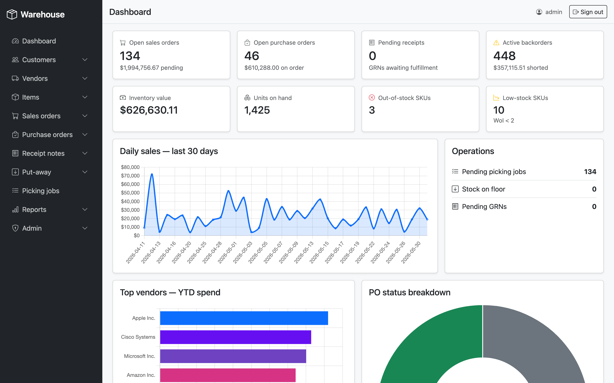
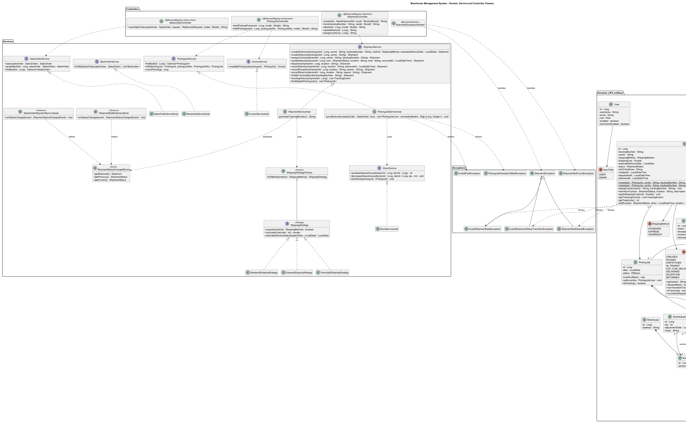
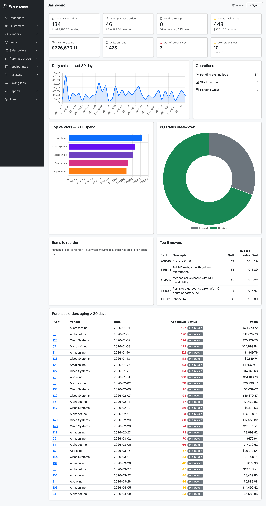
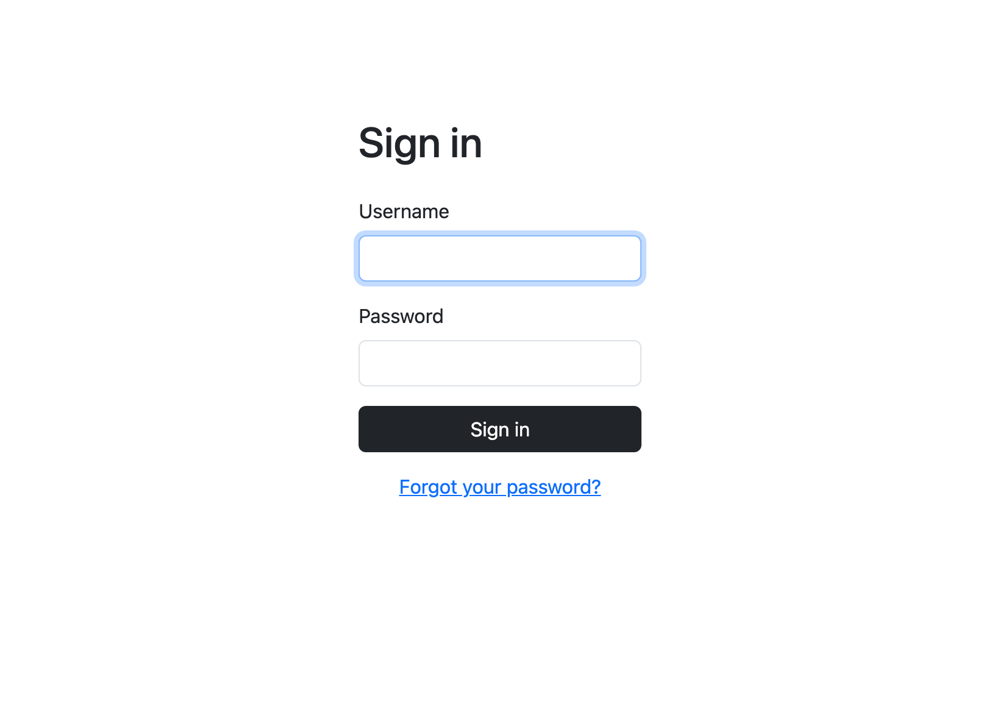
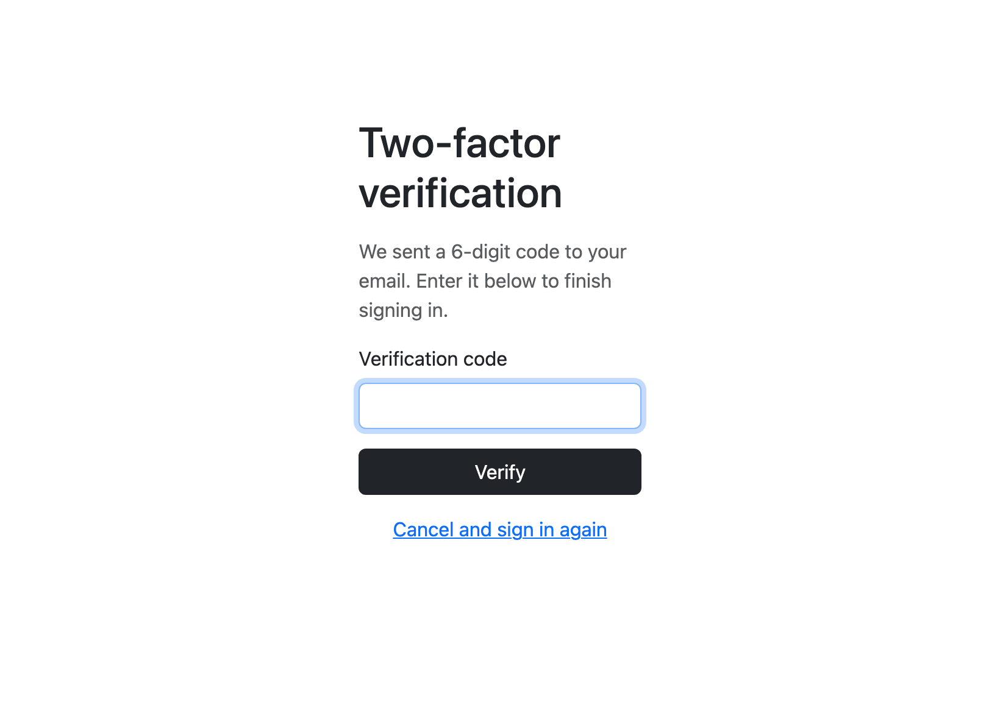
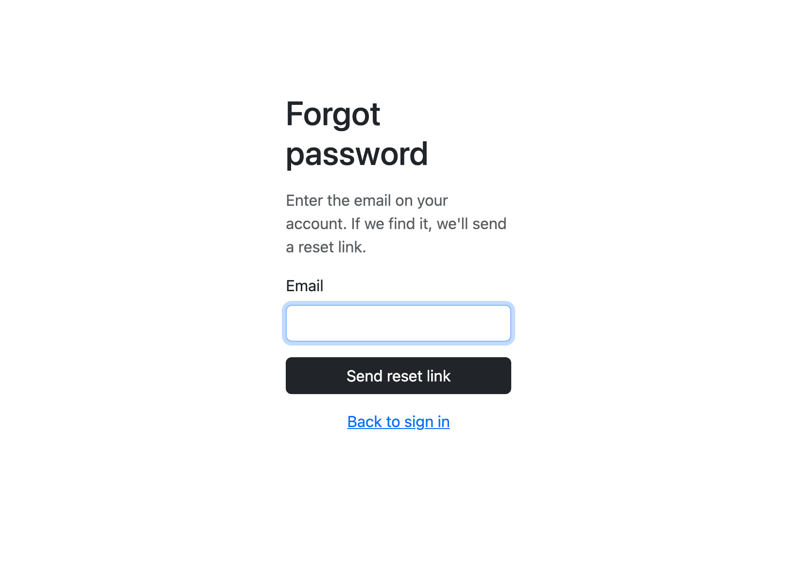
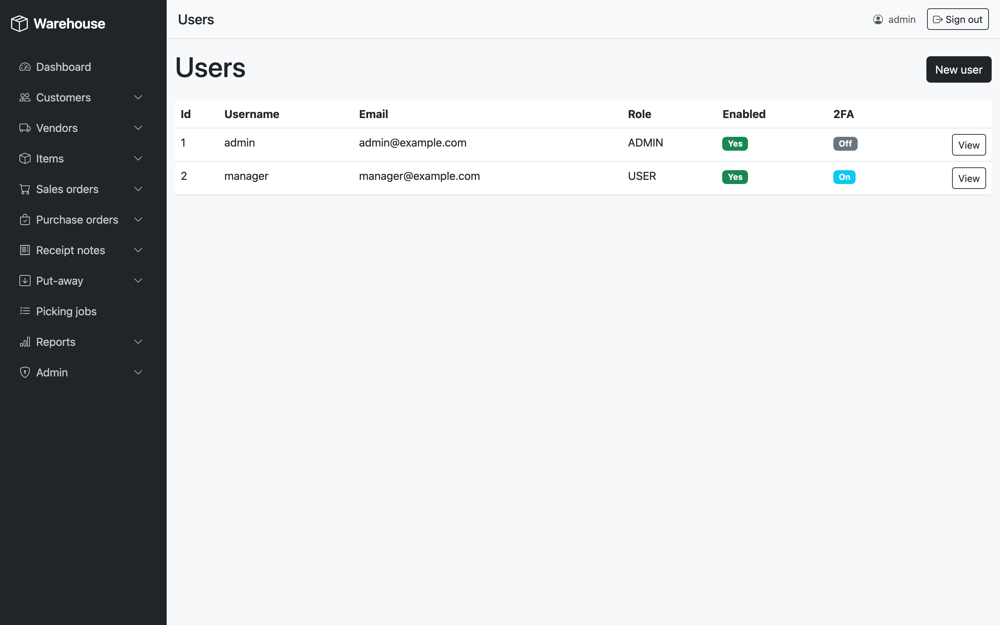

# Warehouse Management System

An Object Oriented Methodology (OOM) project: a Spring Boot web application for inventory tracking, vendor (supplier) management, order fulfilment and shipment tracking.



## Overview

Customers, vendors, items, sales orders, purchase orders, goods receipt notes, put-aways, picking jobs, shipments, invoices, stock adjustments and backorders, behind Spring Security form login with optional email 2FA.

## Problem statement

Small warehouses track stock, suppliers and deliveries in spreadsheets. Quantities drift, orders ship without a trace, and nobody knows where a parcel is. This system keeps one consistent model of stock, orders and shipments, and enforces the business rules in code.

## Objectives

- Track inventory per warehouse section, with audited adjustments.
- Manage vendors, purchase orders and goods receipt.
- Fulfil sales orders through picking jobs, invoices and backorders.
- Track shipments through a validated status lifecycle with an event history.
- Show the OOM concepts clearly: encapsulation, abstraction, inheritance, polymorphism, association/aggregation/composition, SOLID, patterns, exception handling, modularity (see [docs/OOM-CONCEPTS.md](docs/OOM-CONCEPTS.md)).

## Features

- Operational dashboard (KPIs, Chart.js charts, reorder and aging tables).
- Vendor, customer, item and price/cost management with advanced search and type-ahead suggestions.
- Purchase orders, GRNs, put-away, sales orders, picking jobs, invoices, backorders.
- Shipment tracking: create from a fulfilled picking job, carrier and tracking number, status transitions, tracking history, track-by-number page.
- Stock adjustments (cycle count, write-off, transfer).
- Authentication: BCrypt, optional email 2FA, password reset, admin user CRUD.
- Seeded demo data on first start.

## Tech stack

Java 17, Spring Boot 3.2.1, Spring MVC + Thymeleaf, Spring Data JPA (Hibernate), Spring Security 6, H2 (file mode), Flyway, Bootstrap 5, Chart.js 4, Lombok, JUnit 5 / Mockito / MockMvc, Maven.

## Architecture

Layered: Controllers -> Services (interface + Impl) -> Repositories -> Entities. Details: [docs/ARCHITECTURE.md](docs/ARCHITECTURE.md). Entity relationships: [docs/RELATIONSHIPS.md](docs/RELATIONSHIPS.md).

## Documentation

- [docs/OOM-CONCEPTS.md](docs/OOM-CONCEPTS.md): every OOM concept mapped to real classes.
- [docs/ARCHITECTURE.md](docs/ARCHITECTURE.md): layers, workflows, patterns.
- [docs/TESTING.md](docs/TESTING.md): test strategy and how to run.
- [docs/RELATIONSHIPS.md](docs/RELATIONSHIPS.md): association, aggregation, composition.
- [docs/audit/](docs/audit/): repository audits and implementation plan.

## UML diagrams

PlantUML sources (see [docs/uml/README.md](docs/uml/README.md) for how to render them):

- [Use-case diagram](docs/uml/use-case-diagram.puml)
- [Class diagram](docs/uml/class-diagram.puml)
- [Sequence diagram](docs/uml/sequence-diagram.puml)
- [Activity diagram](docs/uml/activity-diagram.puml)
- [State machine diagram](docs/uml/state-diagram.puml)

Rendered images: [docs/uml/images/](docs/uml/images/)



## Screenshots

### Landing page (dashboard)
The login lands here. KPI strip across the top, inventory snapshot, 30-day daily-sales chart, vendor spend, PO status doughnut, reorder list, top movers, and PO aging.



### Sidebar navigation
Each section expands inline. Page title and signed-in user appear in the topbar.


### Sign in
Form login at `/login`. Forgot-password link sends a reset email.



### Two-factor verification
Users with 2FA enabled are diverted to `/verify-2fa` after a correct password. A 6-digit code is generated, BCrypt-hashed, and emailed (logged to the console as a dev fallback when SMTP isn't configured).



### Forgot password
Always shows the same banner, regardless of whether the email matches an account — no enumeration.



### Admin user management
`/admin/users` — list, create, edit, enable/disable, toggle 2FA, delete. ROLE_ADMIN only.



---

## Run it

Java 17 and the bundled Maven wrapper are all you need.

```bash
./mvnw spring-boot:run
```

Then open <http://localhost:8080> and sign in with one of the seeded accounts:

| Username  | Password        | Role   | 2FA |
|-----------|-----------------|--------|-----|
| `admin`   | `Password123!`  | ADMIN  | off |
| `manager` | `Password123!`  | USER   | on  |

Signing in as `manager` triggers the 2FA flow. By default SMTP is not configured, so the 6-digit code is printed to the app log (search for `Your verification code is:`) instead of being emailed. To deliver real emails, see the next section.

### Configure email for 2FA and password reset

Outbound mail (2FA codes, password-reset links) goes through standard Spring Mail. Without credentials, `EmailService` falls back to logging the message body to the console — useful for dev, but you'll want real delivery for any other use case.

1. **Copy the env template and fill in your SMTP details.** A `.env.example` ships at the project root; copy it to `.env` (already gitignored) and edit:
   ```bash
   cp .env.example .env
   ```
   ```bash
   # .env
   MAIL_HOST=smtp.gmail.com
   MAIL_PORT=587
   MAIL_USERNAME=you@gmail.com
   MAIL_PASSWORD=your-app-password
   MAIL_FROM=no-reply@yourdomain.com
   APP_BASE_URL=http://localhost:8080
   ```
   For Gmail, `MAIL_PASSWORD` must be an [App Password](https://support.google.com/accounts/answer/185833), not your account password.

2. **Source the file before launching.** Spring Boot doesn't auto-load `.env`; you have to export the values into the shell first:
   ```bash
   set -a; source .env; set +a
   ./mvnw spring-boot:run
   ```
   `set -a` makes every variable that `source` introduces visible to child processes; `set +a` turns that behavior off after. The Maven plugin then forwards them to the Spring Boot JVM, where `application.properties` picks them up via `${MAIL_HOST}` etc.

3. **Point the `manager` account at a real inbox.** The seeded address `manager@example.com` doesn't go anywhere. Log in as `admin / Password123!` → **Users** (`/admin/users`) → click `manager` → **Update** → set Email → save. The next 2FA login as `manager` will deliver the code to that address.

   If you'd rather skip the UI, run this against the H2 console (<http://localhost:8080/h2-console>):
   ```sql
   UPDATE app_user SET email = 'you@yourdomain.com' WHERE username = 'manager';
   ```

**Alternatives to the sourced `.env` flow**, in case it doesn't fit your setup:

- **IntelliJ / VS Code run configuration** — paste the variables into the Run Configuration's "Environment variables" field. No `.env` file on disk.
- **`src/main/resources/application-local.properties` + `--spring.profiles.active=local`** — Spring-native. Values live in the source tree; gitignore the file.
- **[`spring-dotenv`](https://github.com/paulschwarz/spring-dotenv)** — one Maven dependency makes Spring auto-load `.env` from the project root. Worth it if you do this often.

### Useful commands

```bash
./mvnw spring-boot:run                                # run on :8080
./mvnw clean package                                  # build the jar
./mvnw clean test                                     # run tests (offline: mvn -o test)
./mvnw -Dtest=TrieTest test                           # run one test class
./mvnw -Dtest=TrieTest#getWordList test               # run one test method
```

The H2 console is exposed at <http://localhost:8080/h2-console> (JDBC URL `jdbc:h2:file:./data/warehouse`, user `sa`, no password) for ad-hoc SQL against the running database.

---

## Core domain workflow

1. **Purchase order** -> a **goods receipt note (GRN)** is opened against it.
2. Fulfilling the GRN creates **stock** rows on a floor section (`00-00-0-0`).
3. **Put-away** moves stock from the floor to a real warehouse section.
4. Saving a **sales order** creates a **picking job** that mirrors each order line.
5. Fulfilling the picking job decrements stock, writes an **invoice**, and creates **backorders** for unmet quantities.
6. A **shipment** is created for a fulfilled picking job and moves through `ShipmentStatus` until delivered or returned.

## Database configuration

- H2 in **file mode**: `spring.datasource.url=jdbc:h2:file:./data/warehouse;AUTO_SERVER=TRUE` (user `sa`, empty password). Data survives restarts and lives in `./data/` (git-ignored).
- **Flyway owns the schema**: migrations in `src/main/resources/db/` (`V1__baseline.sql`, `V2__stock_adjustments.sql`, `V3__shipments.sql`). Hibernate runs with `spring.jpa.hibernate.ddl-auto=validate`, so any entity change needs a new `V<n>__*.sql`; never edit an applied migration.
- To reset the data, stop the app and delete `./data/`.

## Project layout

```
src/main/java/com/example/warehouseManagement/
  Bootstrap/     seed data runner
  Controllers/   Spring MVC controllers and exception handlers
  Domains/       JPA entities, enums
    DTOs/        form and projection DTOs
    Exceptions/  domain exceptions
  Repositories/  Spring Data repositories
  Security/      SecurityConfig, 2FA success handler
  Services/      interface + Impl per capability
  Util/, DSA/    helpers (Counter, Trie, BinarySearchTree)
src/main/resources/  application.properties, db/ (Flyway), templates/
src/test/java/...    unit, repository and controller tests
docs/                documentation, screenshots, audits, uml/
```

## Testing

```bash
./mvnw clean test                 # normal
mvn -o test                       # offline (no network), uses the local Maven cache
mvn -o test -Dtest=ShipmentServiceImplTest
```

See [docs/TESTING.md](docs/TESTING.md).

## Team contribution

| Member | Responsibilities |
|---|---|
| _to be filled in by the team_ | _..._ |

## Known limitations

- Native report/dashboard queries use H2 syntax; another database needs them rewritten.
- Seeded demo credentials are for development only.
- Email falls back to console logging when SMTP is not configured.
- No tax or carrier API integration; shipment status is updated manually.

## License

MIT.
