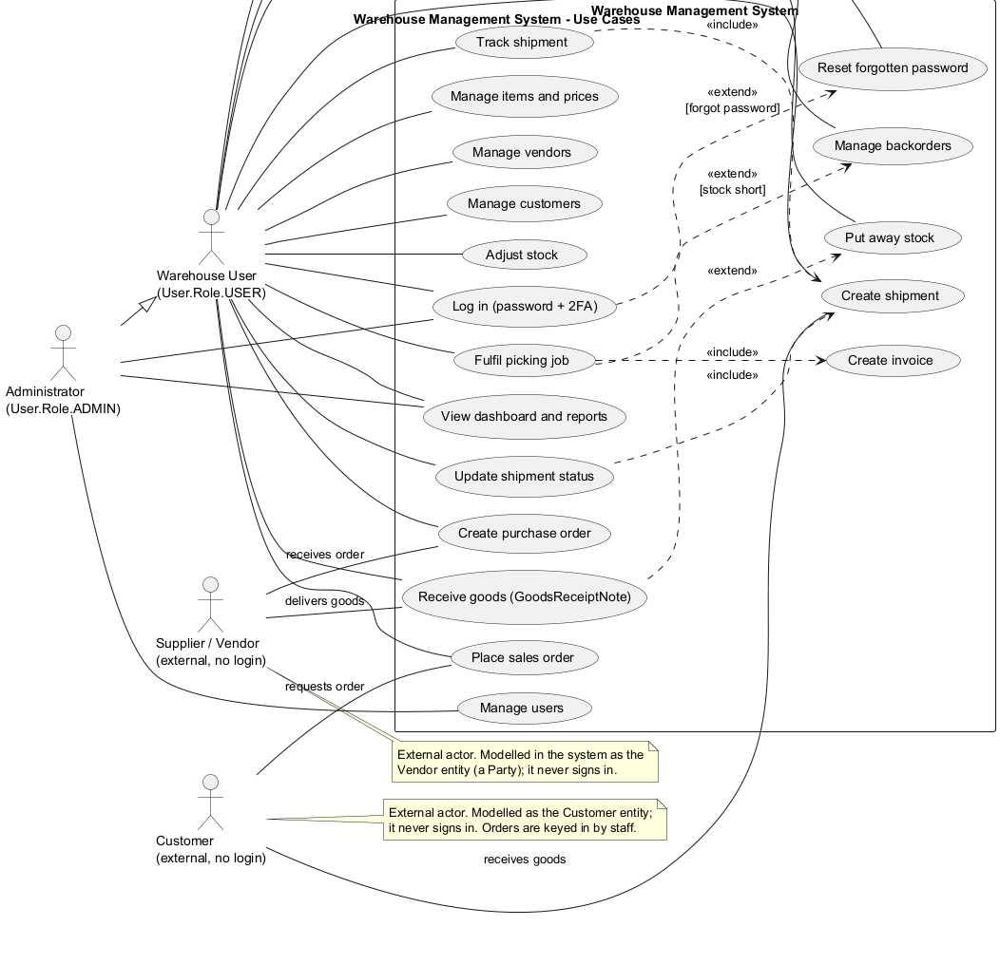
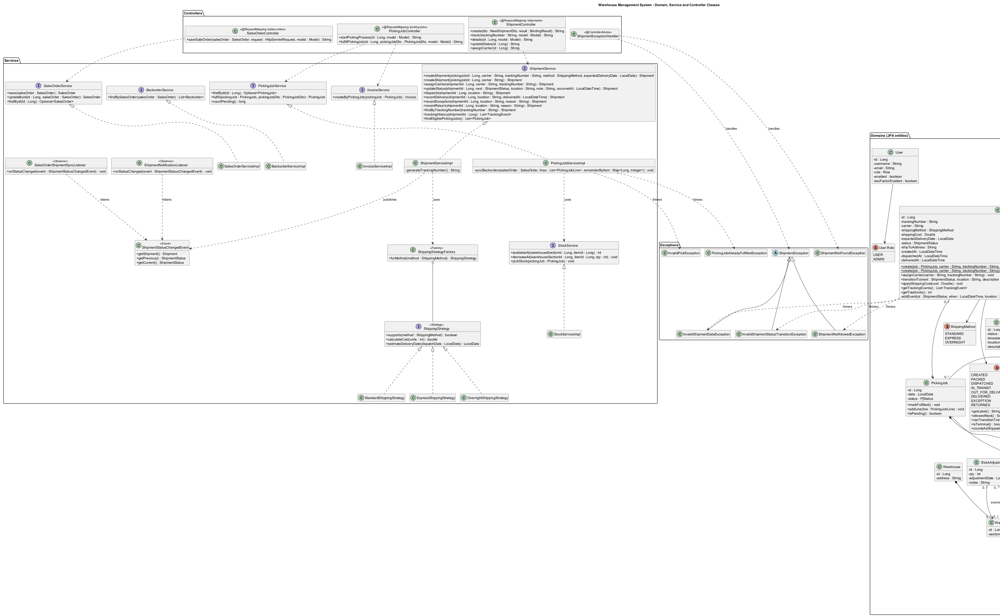
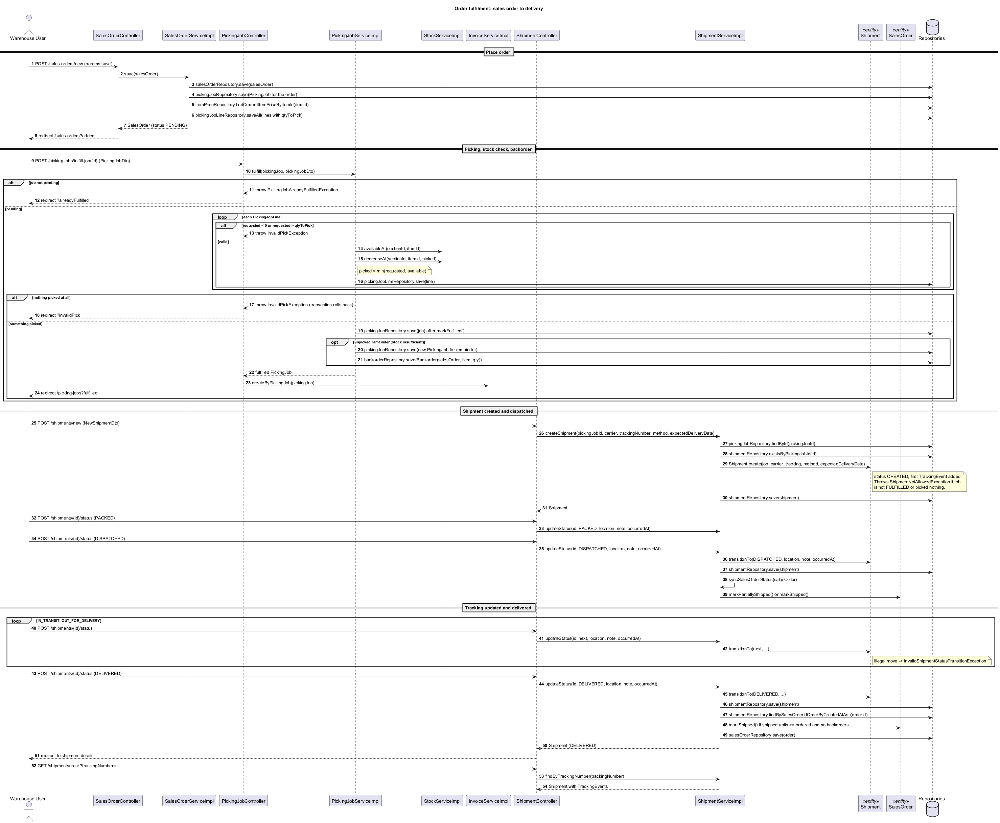
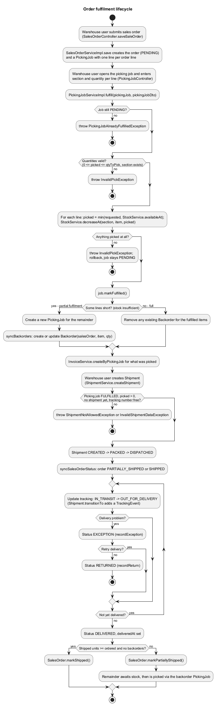
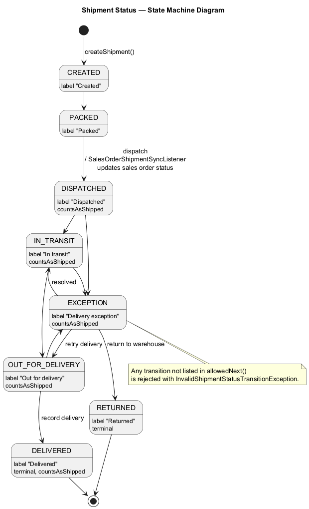

# UML diagrams

PlantUML sources, written from the code on `main`.

| File | Diagram |
|---|---|
| `use-case-diagram.puml` | Actors (ADMIN and USER roles, external Supplier and Customer) and use cases |
| `class-diagram.puml` | Entities, enums, services, controllers, exceptions; composition, aggregation, association as in `docs/RELATIONSHIPS.md` |
| `sequence-diagram.puml` | Sales order to picking, backorder, shipment, dispatch, tracking, delivery |
| `activity-diagram.puml` | Fulfilment lifecycle with validation, stock, partial fulfilment, backorder, exception and return decisions |
| `state-diagram.puml` | Shipment status state machine (`ShipmentStatus.allowedNext()`) |
| `DISCREPANCIES.md` | Diagram versus code comparison |

## Rendering

Pre-rendered PNG and SVG images are in [images/](images/).

* PlantUML jar (Java only, no Graphviz needed with the built-in layout): `java -jar plantuml.jar -Playout=smetana -tpng -o images docs/uml/*.puml`
* VS Code: install the "PlantUML" extension, open a `.puml` file, press `Alt+D`.
* Online: paste the file text into https://www.plantuml.com/plantuml

## Diagrams

### Use-case diagram

### Class diagram

### Sequence diagram

### Activity diagram

### State machine diagram

